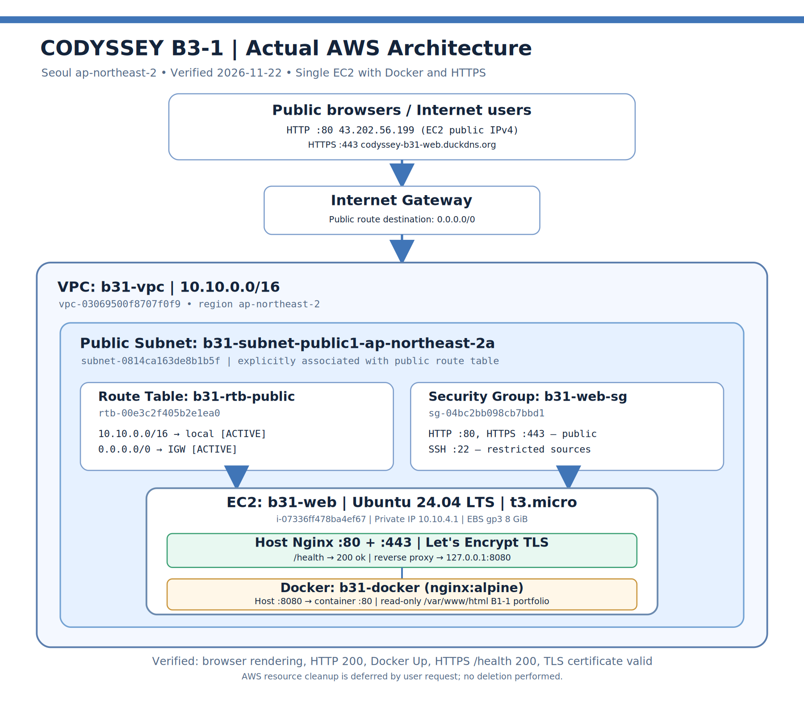
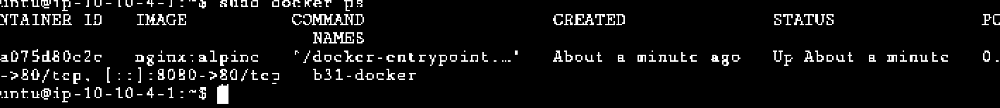
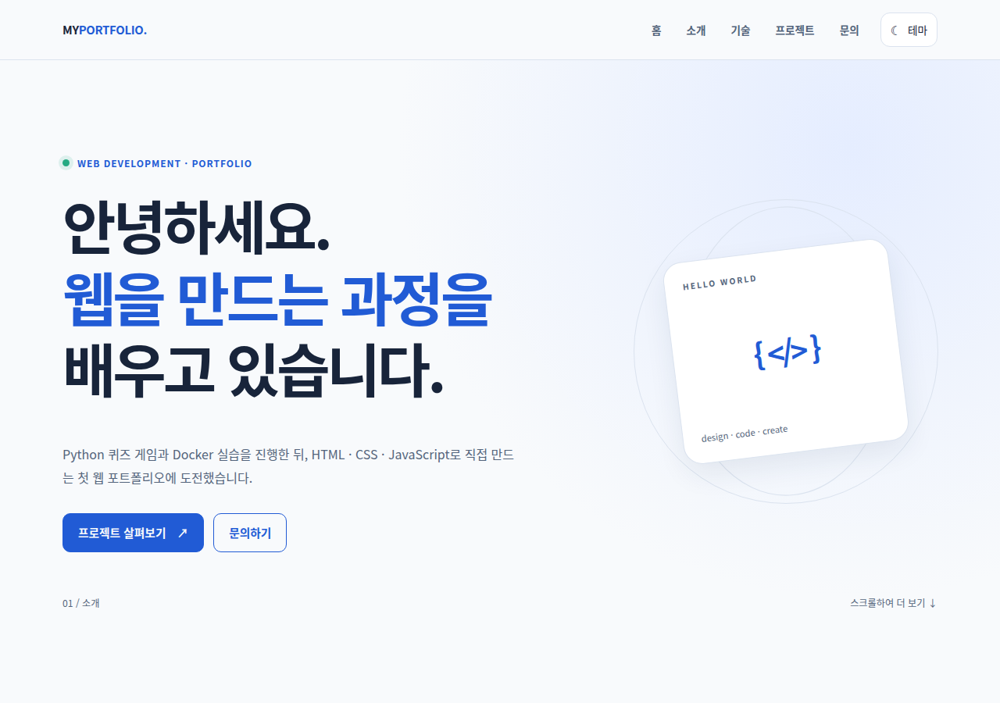
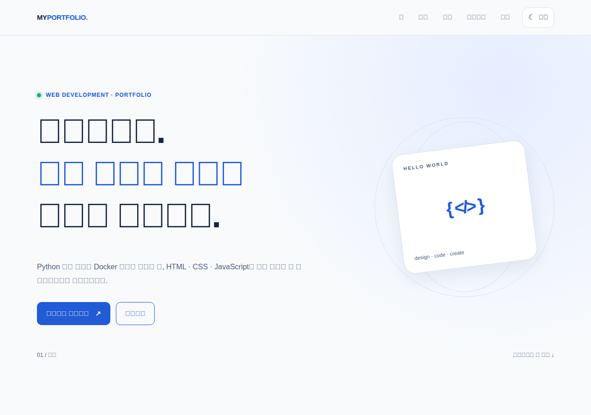
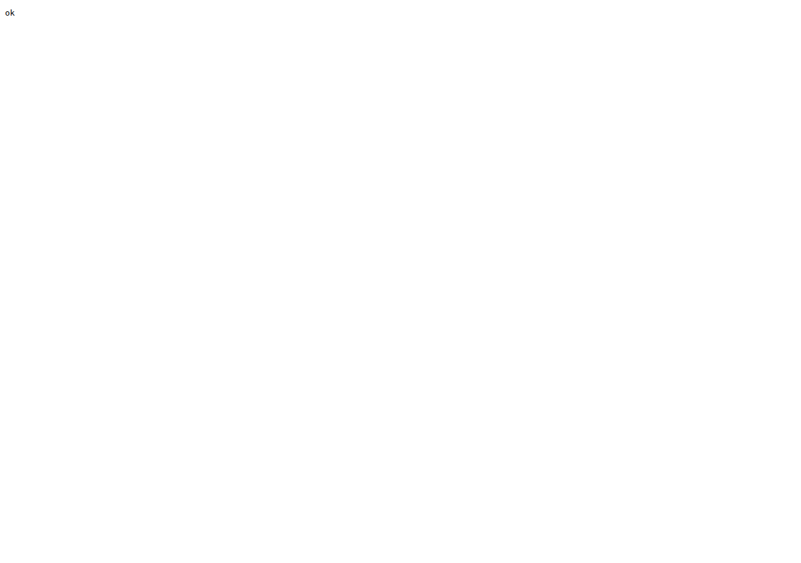

# B3-1 사진으로 확인하는 증빙 기록

이 문서는 **실제로 수행한 작업의 설명 바로 아래에 해당 결과 화면**을 배치한 열람용 기록입니다. 사진과 명령 출력은 서로 보완합니다. **AI 사전평가는 이미지 파일을 읽지 않으므로**, 평가용 사실관계는 [README의 텍스트 증빙](../../README.md)과 [7개 실행 검증](../validation-2026-11-22.md)에 별도로 남겨 두었습니다.

## 1. AWS 네트워크 구조와 실제 연결

- 서울 `ap-northeast-2`, VPC `b31-vpc` (`10.10.0.0/16`).
- 퍼블릭 서브넷 `b31-subnet-public1-ap-northeast-2a`.
- 라우팅 테이블 `b31-rtb-public`: `10.10.0.0/16 → local`, `0.0.0.0/0 → b31-igw`, 두 경로 활성.
- Internet Gateway `igw-09322346b5d9055a8`.
- EC2 `b31-web`, 호스트 Nginx, Docker `b31-docker`, HTTPS까지 연결.

**실제 구성값을 반영한 PNG**

라우팅 테이블의 실제 확인값: [AWS 콘솔 텍스트 기록](../network-console-verification-2026-11-22.md). 원본 콘솔 캡처는 계정 정보가 포함되어 현재 공개 저장소에서 제외했습니다.

## 2. Docker 컨테이너 실행 상태

- 명령: `sudo docker ps`
- 컨테이너: `b31-docker`, 이미지 `nginx:alpine`, 상태 `Up 2 hours` (검증 당시).
- 호스트 `8080` → 컨테이너 `80`; `curl -I http://localhost:8080/`에서 `HTTP/1.1 200 OK`.

**사용자가 실행한 EC2 터미널의 실제 캡처**

이 캡처는 사용자 터미널 화면의 알림·AWS 계정 정보가 있는 바깥 부분을 제외한 **실제 크롭본**입니다. 출력 전문과 분리된 확인값은 [종합 검증 기록](../validation-2026-11-22.md)에 있습니다.

## 3. 과제 방식 A — 공인 IPv4의 HTTP 브라우저 실제 화면

- 과제 원문 방식 A: 외부 브라우저에서 `http://<퍼블릭IP>` 접속 시 페이지 정상 로딩.
- 실습 당시 공인 주소: `http://43.202.56.199/`.
- GitHub Actions에서 외부 HTTP 요청 `200`을 기록하고, **Chrome을 직접 실행해 HTTP 주소의 실제 포트폴리오를 촬영**했다. 새 HTTP 캡처 이미지는 2026-11-22 재촬영 및 육안 확인 완료.
- 브라우저의 주소창은 포함되지 않으므로 실행 명령이 담긴 [Actions 촬영 워크플로](../../.github/workflows/capture-external-proof.yml) 및 [HTTP 200 응답 기록](automated-external-check.txt)을 함께 확인해야 한다.

**HTTP 공인 IPv4에 접속한 실제 Chrome 화면**

## 4. 외부 브라우저에서 HTTPS 포트폴리오 표시

- 실습 당시 공인 IPv4: `43.202.56.199`
- 실제 접속 URL: `https://codyssey-b31-web.duckdns.org/`
- 외부 브라우저 HTTP 상태: `200`
- B1-1의 실제 포트폴리오를 HTTPS로 제공.

**외부 Chrome에서 실제 사이트에 접속해 촬영한 화면**

이 이미지는 **GitHub Actions의 Chrome이 공개 도메인에 직접 접속해 새로 촬영**한 결과입니다. 휴대전화 원본을 편집한 캡처 또는 모바일 주소창 캡처로 표시하지 않습니다. URL과 상태 코드는 [외부 검증 텍스트](automated-external-check.txt)에 별도로 기록돼 있습니다.

## 5. HTTPS 상태 확인 경로

- 주소: `https://codyssey-b31-web.duckdns.org/health`
- 실제 상태: `HTTP/1.1 200 OK`, `Content-Type: text/plain`, 본문 `ok`.
- **범위:** 호스트 Nginx의 응답 확인. Docker는 2번에서 따로 검사합니다.

**실제 HTTPS /health 브라우저 화면**

정확한 HTTP 상태와 URL은 [외부 검증 텍스트](automated-external-check.txt), Nginx 응답 헤더와 인증서 만료일은 [7항목 종합 검증](../validation-2026-11-22.md)에서 확인할 수 있습니다.

## 6. IAM 권한 및 SSH 보안 확인

- `b31-learner`로 `iam:ListPolicies`를 호출할 때 `AccessDenied` 확인.
- 관리자 계정에서 `B31PracticePolicy`의 전체 JSON 검토: 서울 리전 조건, `ec2:Describe*`, 인스턴스 생성·중지·종료 및 VPC·라우팅·보안 그룹 관리 Action 포함.
- SSH 22: 개인 단일 IP `/32` + AWS EC2 Instance Connect 관리형 접두사 목록. 공개 웹 80/443과 구분.

문서: [정책 JSON 및 범위](../iam-policy-json-review-2026-11-22.md) · [IAM 접근 거부](../iam-permission-verification-2026-11-22.md) · [SSH 접속 출처](../ssh-security-verification-2026-11-22.md).

**AWS 관리자 화면·모바일 원본 스크린샷은 여기에는 아직 업로드하지 않았습니다.** 계정 정보나 개인 IP를 제거한 공개용 사본을 만들기 전까지 텍스트 설명만 사용합니다.

## 7. 접속 오류 및 해결 기록

[접속 장애 보고서](../troubleshooting.md)에 증상, 가설, 검증, 조치 및 결과를 기록했습니다. **오류 화면 원본은 현재 공개 저장소에 없으므로**, 이 항목에는 다른 사진을 대신 끼워 넣지 않았습니다. 정상화 결과는 위 3·4번의 실제 접속 화면으로 확인합니다.

## 8. AWS 리소스 삭제 — 마지막 절차

[리소스 삭제 체크리스트](../cleanup-checklist.md)에 EC2 Terminate, EBS, 보안 그룹, 라우팅, IGW, 서브넷, VPC 및 Billing 점검 항목을 정리했습니다.

**현재 실제 삭제는 보류 중입니다.** 삭제 전 서비스가 실행되는 증거를 남기고, 최종 검증·평가를 마친 후 삭제 승인을 받아 종료하고, 삭제 완료 후 화면과 텍스트를 이 문서 아래에 추가할 예정입니다.

---

**증빙 자료 전체 목록 및 공개/비공개 구분:** [docs/evidence/README.md](README.md). 별도 비공개 `Imprint`에 모바일 원본을 보관하는 작업은 공개 자료와 구분합니다.
